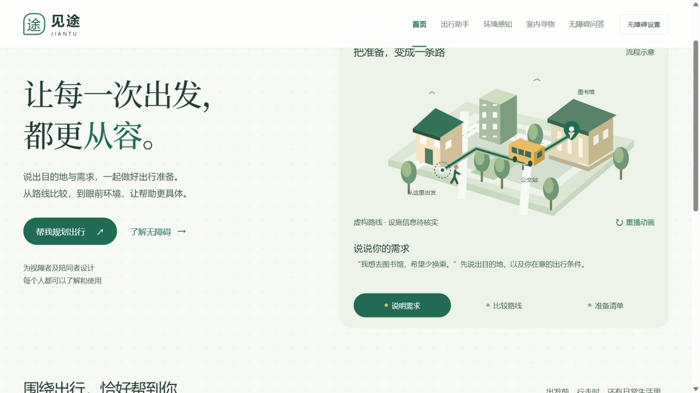
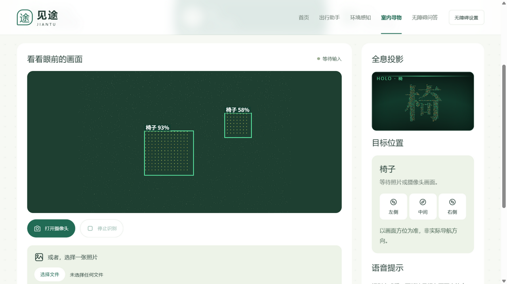
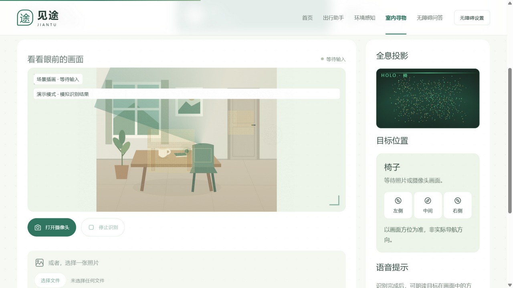
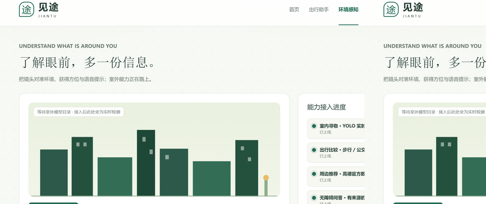

# 见途 Jiantu 🍃

> 面向视障者与陪同者的 AI 出行准备与环境观察助手
> 全国高校AI Web开发挑战赛 参赛作品 · 团队「菁核」· 三江学院 · B组

[](docs/screenshots/home-hero.png)

**见途**相信：科技的温度，在于让每一个人都能从容出发。视障用户说出目的地与偏好，见途比较步行、公交与地铁路线并生成行前核实清单；走出门，摄像头识别身边的障碍物、行人与水坑，用语音播报方位；有了疑问，有来源可查的无障碍知识问答随时解答。

## ✨ 核心玩法

### 🗺️ 出行助手 —— 把准备，变成一条路

输入大致地名，高德候选即输即选；一键比较**步行 / 公交 / 地铁 / 公交＋地铁**四类方案，按「少换乘、减少步行、优先地铁」个性化排序，逐段展示乘车线路与上下车站，并附行前核实清单。



- **AI Agent 工具循环**：GLM-4.6 通过 Function Calling 自主调用地点搜索、周边推荐与路线比较工具，全过程在受限沙箱内完成（工具白名单、轮次上限、结果缓存）
- **SSE 流式输出**：工具开始/结束事件与答案增量实时推送，AI 的每一步都看得见
- **周边推荐零 token 路径**：「附近有什么书店」由规则路由直接调高德官方周边搜索，秒回且不消耗模型额度

### 🔍 室内寻物 —— 全息粒子识别

选择要找的物品（瓶/杯、椅子、门），上传照片或打开摄像头，YOLOv8 本地推理实时框出目标。



**识别粒子可视化**：检出瞬间，整张照片「信息化」为粒子尘——扫描线掠过后，只有被识别的目标区域凝聚成琥珀色粒子薄层停留标注，其余恢复原样。一张照片，看见 AI 注意力的流向。



- 全息粒子投影舱：目标汉字由千余个发光粒子聚合而成，鼠标划过会推开粒子
- 裸眼 3D：照片层与粒子层反向位移，无需眼镜就有深度
- 方位播报：左侧/中间/右侧 + 置信度，Web Speech 朗读

### 🌆 环境感知 —— 街面观察（室外模型接入中）

真实 Three.js 街区待机场景与能力接入进度页。室外模型（障碍物/行人/水坑/车辆四类检测）已完成联调，等待最终版本合入。



### 💬 无障碍问答 —— 有来源的 RAG

覆盖帮助方法、视障认知、设施交通、陪同出行、景点出游五大主题。回答基于知识库检索生成，**每个结论都可溯源**：「来源N」引用可点击定位到来源卡，卡片展示发布机构、日期、核验状态与原文链接；资料不足时明确拒答，不编造。

### 🛟 贴心细节

- **无摄像头演示模式**：`?demo` 一键切换模拟识别场景，评委演示不依赖硬件
- **减少动态**：站内开关与系统偏好双通道，关闭后全部动效呈现终态
- **大字号 / 高对比度**：无障碍设置面板一键切换

## 🧠 AI 技术方案

| 能力 | 实现 |
| --- | --- |
| 大模型集成 | 智谱 GLM-4.6 · Function Calling · SSE 流式 · Token 按天护栏 |
| Agent 设计 | 有界工具循环（白名单/轮次上限/结果缓存/补问策略） |
| RAG | 本地知识库检索 → 带来源生成 → 引用定位 → 拒答兜底 |
| 多模态 | YOLOv8 本地视觉推理（室内/室外双模型）+ Web Speech 语音播报 |
| 可控性 | 诚实边界声明 · 演示数据明确标示 · 未核验信息醒目提示 |

## 🌱 赛道契合：AI 健康与生活服务

全国有 1700 万+ 视障人群，他们的出行准备往往依赖他人。见途把「出行前的焦虑」拆解成 AI 可以帮上忙的小事：查路线、比方案、记清单、认环境、答疑解惑——**让科技成为出门的底气，而不是新的门槛**。全站遵循无障碍设计（读屏兼容、键盘可达、减少动态、高对比度），AI 在这里促进的是公平与包容。

## 🚀 快速开始

```bash
git clone https://github.com/fengkai-jinji/jiantu-ai-travel.git
cd jiantu-ai-travel
npm install
cp .env.example .env   # 填入高德与智谱 API Key
npm run dev            # http://127.0.0.1:5173
```

感知服务（本地 YOLO 推理）与环境变量说明见 [docs/](docs/)。

## 🙏 致谢

感谢三江学院与指导老师的悉心指导，感谢队友的并肩作战——从模型训练到网页打磨，每一个版本都在一起反复推敲。也感谢所有无障碍社区的先行者，让「包容」成为设计的起点。

## 📄 如实声明

本项目由参赛学生主导、AI 辅助编程完成，学生对全部代码逻辑负责。识别与路线结果为参考信息，不构成安全导航承诺；知识问答标注来源与核验状态。
