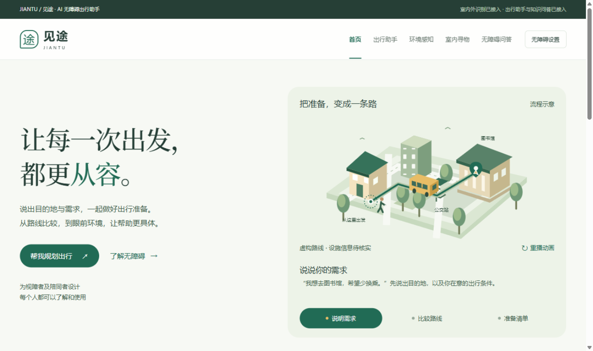
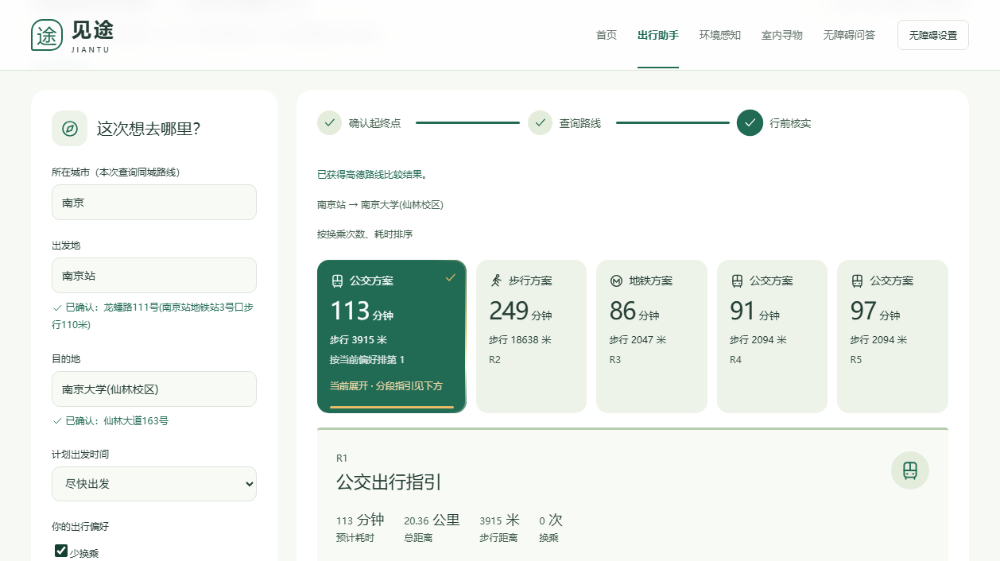
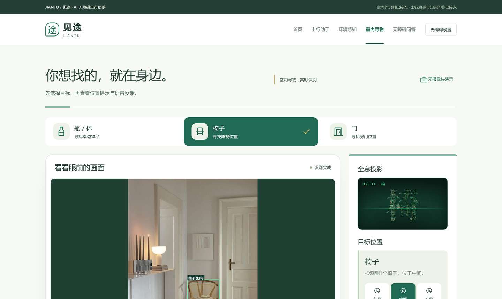
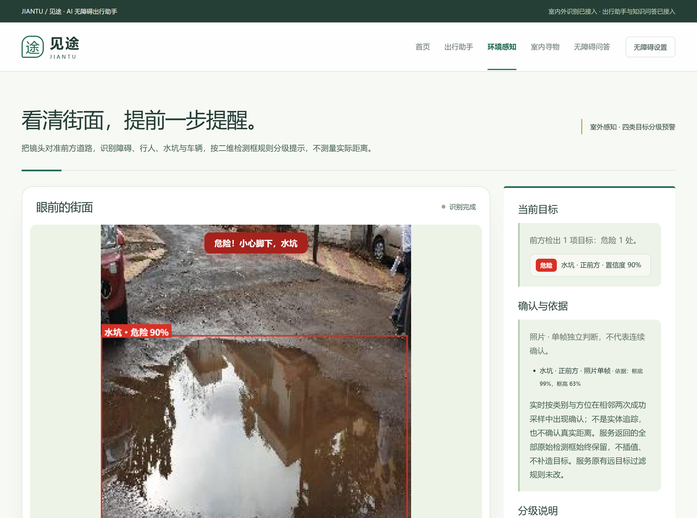
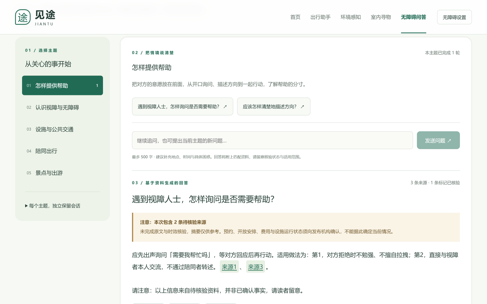

# 见途 Jiantu 🍃

> 面向视障者与陪同者的 AI 出行准备与环境观察助手
> 全国高校AI Web开发挑战赛 参赛作品 · 团队「菁核」· 三江学院 · B组

[](docs/screenshots/home-hero.png)

**见途**相信：科技的温度，在于让每一个人都能从容出发。视障用户说出目的地与偏好，见途比较步行、公交与地铁路线并生成行前核实清单；走出门，摄像头识别身边的障碍物、行人与水坑，用语音播报方位；有了疑问，有来源可查的无障碍知识问答随时解答。

## ✨ 核心玩法

### 🗺️ 出行助手 —— 把准备，变成一条路

输入大致地名，高德候选即输即选；一键比较**步行 / 公交 / 地铁 / 公交＋地铁**四类方案，按「少换乘、减少步行、优先地铁」个性化排序，逐段展示乘车线路与上下车站，并附行前核实清单。



- **AI Agent 工具循环**：GLM-4.6 通过 Function Calling 自主调用地点搜索、周边推荐与路线比较工具，全过程在受限沙箱内完成（工具白名单、轮次上限、结果缓存）
- **SSE 流式输出**：工具开始/结束事件与答案增量实时推送，AI 的每一步都看得见
- **周边推荐零 token 路径**：「附近有什么书店」由规则路由直接调高德官方周边搜索，秒回且不消耗模型额度

### 🔍 室内寻物 —— 全息粒子识别

选择要找的物品（瓶/杯、椅子、门），上传照片或打开摄像头，YOLOv8 本地推理实时框出目标。



**识别粒子可视化**：识别完成后，只有被检出的目标区域覆上一层琥珀色粒子薄层停留标注，其余画面恢复原样；中文标签给出目标与置信度。一张照片，看见 AI 注意力的流向。

- 全息粒子投影舱：目标汉字由千余个发光粒子聚合而成，鼠标划过会推开粒子
- 裸眼 3D：照片层与粒子层反向位移，无需眼镜就有深度
- 方位播报：左侧/中间/右侧 + 置信度，Web Speech 朗读；同场景多目标时按方位分别给出置信度
- 模型口径：现行 v3（训练集 5055 张）。旧测试集与训练同源、指标虚高，已重建 1452 张干净测试集重测：椅子近景召回 0.83，远景目标仍易漏检。界面上因此不写「识别准确率」，只写模型能做什么、做不到什么，完整数据见 `model-training/indoor/eval/REPORT.md`

### 🌆 环境感知 —— 街面分级预警

镜头对准前方道路，识别**障碍物 / 行人 / 水坑 / 车辆**四类目标，按二维检测框的位置与高度分级提示，危险级目标抢占播报。



- **三级预警**：危险 / 近 / 中，依据检测框底边位置与框高判定；水坑进入画面中部即按「近」处理
- **方位判定**：左前方 / 正前方 / 右前方，配合不同播报话术
- **路线外过滤**：车辆中心落在画面两侧边缘带时标记「路线外」，避免对路边停放车辆误报
- **语音节奏**：危险级 2 秒、近级 4 秒冷却去重；危险出现时打断当前播报，水坑固定话术「小心脚下，水坑」
- **如实边界**：只按二维框规则分级，**不测量实际距离**；照片为单帧独立判断，不做实体追踪

### 💬 无障碍问答 —— 有来源的 RAG

覆盖帮助方法、视障认知、设施交通、陪同出行、景点出游五大主题。回答基于知识库检索生成，**每个结论都可溯源**：「来源N」引用可点击定位到来源卡，卡片展示发布机构、日期、核验状态与原文链接；资料不足时明确拒答，不编造。



### 🛟 贴心细节

- **无摄像头演示模式**：`?demo` 一键切换模拟识别场景，评委演示不依赖硬件
- **减少动态**：站内开关与系统偏好双通道，关闭后全部动效呈现终态
- **大字号 / 高对比度**：无障碍设置面板一键切换

## 🧠 AI 技术方案

| 能力 | 实现 |
| --- | --- |
| 大模型集成 | 智谱 GLM-4.6 · Function Calling · SSE 流式 · Token 按天护栏 |
| Agent 设计 | 有界工具循环（白名单/轮次上限/结果缓存/补问策略） |
| RAG | 本地知识库检索 → 带来源生成 → 引用定位 → 拒答兜底 |
| 多模态 | YOLOv8 本地视觉推理（室内寻物 + 室外街面双模型）· 二维框分级 · Web Speech 播报 |
| 可控性 | 诚实边界声明 · 演示数据明确标示 · 未核验信息醒目提示 |

## 🌱 赛道契合：AI 健康与生活服务

全国有 1700 万+ 视障人群，他们的出行准备往往依赖他人。见途把「出行前的焦虑」拆解成 AI 可以帮上忙的小事：查路线、比方案、记清单、认环境、答疑解惑——**让科技成为出门的底气，而不是新的门槛**。全站遵循无障碍设计（读屏兼容、键盘可达、减少动态、高对比度），AI 在这里促进的是公平与包容。

## 📁 仓库结构

```
见途/
├─ README.md               本文件
├─ 启动项目.ps1            一键拉起全部服务（Windows 双击即用）
├─ src/                    前端源码（React + TypeScript）——唯一一份
├─ server/                 后端：8766 地图/Agent/知识问答，8767 室外识别，8765 室内识别
├─ tests/                  前端与接口测试
├─ public/assets/          页面静态插画
├─ 便携推理包/             室外识别权重，server/outdoor.py 直接加载，请勿改名
├─ model-training/
│  ├─ indoor/              室内三类（瓶/杯、椅子、门）训练产物，现行 v3，v2 回退
│  │  └─ eval/             干净测试集构建与 v2/v3 对比评测，含结论 REPORT.md
│  ├─ outdoor/             室外四类（障碍/行人/水坑/车辆）训练配置
│  └─ llm-rag/             LLM 微调语料与评测脚本
├─ docs/
│  ├─ screenshots/         页面截图（README 引用，更新页面请同步换图）
│  ├─ notes/               设计、进度、问题记录等项目过程文档
│  └─ *.md                 接口说明与交接文档
├─ scripts/                一次性历史脚本（不参与运行）
└─ 测试区/                 浏览器实测记录与验收证据
```

改动代码只需要动 `src/` 与 `server/`，其余目录是资料、权重与证据。`dist/`、`网页/`、`Ultralytics/`、日志与 `node_modules/` 均不入库。

## 🚀 快速开始

```bash
git clone https://github.com/fengkai-jinji/jiantu-ai-travel.git
cd jiantu-ai-travel
npm install
cp .env.example .env   # 填入高德与智谱 API Key
npm run dev            # http://127.0.0.1:5173
```

识别能力由本地推理服务提供，与前端分开启动（端口与代理已在 `vite.config.ts` 中配好）：

```bash
python server/maps.py      # 8766 · 地图 / Agent / 知识问答
python server/outdoor.py   # 8767 · 室外街面识别（使用 便携推理包/ 中的权重）
python server/indoor.py    # 8765 · 室内寻物识别（使用 model-training/indoor/ 中的权重）
```

三个识别服务都只依赖 `ultralytics + opencv + numpy`，权重已随仓库提供，clone 后无需另装模型即可运行。室内缺省加载 `model-training/indoor/products_v3`（训练集 5055 张），`products_v2`（训练集 2370 张）保留作回退：请求带 `mode=v2` 即切回，不必重启服务。两版类别口径一致，均为瓶/杯、椅子、门三类；`GET /api/status` 会列出各版本权重是否就位。

权重只在首次收到图片时加载，服务先起、模型后载，启动脚本因此不会被 19 MB 的模型卡住；服务不可用时室内页给出明确报错而不虚构结果。

Windows 下也可直接双击 `启动项目.ps1`，脚本会依次拉起服务与前端，等接口就绪后自动打开浏览器。环境变量与模型说明见 [docs/](docs/)。

## 🙏 致谢

感谢三江学院与指导老师的悉心指导，感谢队友的并肩作战——从模型训练到网页打磨，每一个版本都在一起反复推敲。也感谢所有无障碍社区的先行者，让「包容」成为设计的起点。

## 📄 如实声明

本项目由参赛学生主导、AI 辅助编程完成，学生对全部代码逻辑负责。识别与路线结果为参考信息，不构成安全导航承诺；知识问答标注来源与核验状态。
